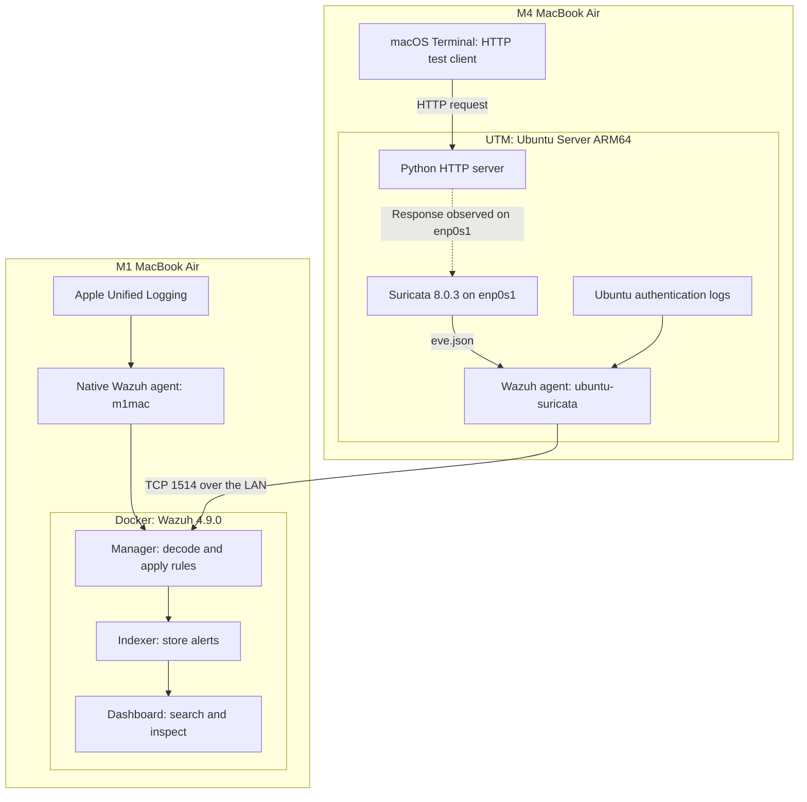
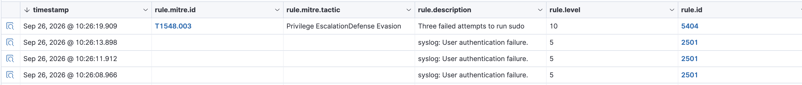
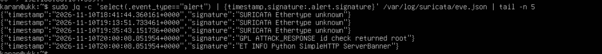
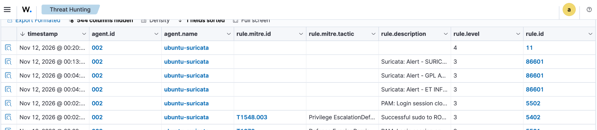

# Wazuh SIEM home lab on macOS and Ubuntu

I built a small security monitoring lab on two Apple Silicon MacBooks. The M1 runs Wazuh 4.9.0 in Docker and has a native agent that collects macOS authentication events. The M4 hosts an Ubuntu Server VM in UTM. Inside that VM, Suricata inspects network traffic and a second Wazuh agent forwards its alerts to the M1.

I validated two detections: three failed attempts to run `sudo` on macOS, and a network signature triggered by a harmless HTTP response served from Ubuntu.

## Architecture

The Ubuntu agent reports activity inside the guest. Its Suricata sensor sees traffic visible to the guest's network interface. Running the HTTP client in a separate macOS Terminal tab made the test response cross that interface. Bridging the VM to Wi-Fi does not give it visibility into every device's traffic.

## Detection 1 · Failed sudo authentication on macOS

**Question.** Can I see a user repeatedly failing to authenticate for an administrative command? The original setup polled `log show` and searched for the word `incorrect`. That missed relevant authentication messages and did not produce the expected alerts.

I switched to Wazuh's native macOS log collector. Its query selects the `sudo` process, authentication failures from `opendirectoryd`, and `sshd` messages. I also applied a logging profile scoped to `com.apple.opendirectoryd` so redacted account details could be inspected for this lab. The repository includes the [agent configuration sample](configs/ossec.conf.sample) and the [subsystem logging profile](configs/EnablePrivateData.mobileconfig).

**Result.** A controlled sudo test produced individual authentication failures and a higher-level alert in Threat Hunting.

| Wazuh rule | Level | Evidence |
|---|---:|---|
| `2501` | 5 | Individual authentication-failure messages |
| `5404` | 10 | Sudo's message reporting three incorrect password attempts |

*Read the four rows from bottom to top. The three individual failures and the sudo summary are separate records. In the [4.9.0 ruleset](https://github.com/wazuh/wazuh/blob/v4.9.0/ruleset/rules/0020-syslog_rules.xml), rule 5404 matches the summary message and carries MITRE ATT&CK mapping T1548.003.*

## Detection 2 · A Suricata alert from Ubuntu reaches Wazuh

**Question.** If a response crossing the VM's interface contains text matching a network signature, can I trace the result from the sensor to the dashboard?

From the M4, I requested a page hosted inside Ubuntu. The test page contained `uid=0(root)`. Suricata matched signature **2100498** on the HTTP response and also identified the Python HTTP server banner. I checked the signatures in the VM's EVE JSON log and located the corresponding Ubuntu agent alerts under Wazuh rule **86601**.

*Local evidence. The two signatures share a timestamp. The earlier unknown-EtherType rows are separate observations.*

*Central evidence. Agent 002, ubuntu-suricata, reported the GPL and ET INFO alerts. The same agent also reported Ubuntu PAM session events and successful sudo use. The alert named “id check returned root” identified text that I deliberately served. No privileged command was required to produce that text.*

[Reproduce the local HTTP test and verify both alert IDs](docs/suricata-http-test.md).

## Troubleshooting lessons

- **Check the evidence behind a dashboard count.** An authentication summary tile showed zero during testing. Filtering Threat Hunting by agent and selecting the actual test time exposed the individual rule hits.
- **Choose the manager address from the agent's point of view.** The M1's own agent can reach a locally published manager port at `127.0.0.1:1514`. The Ubuntu guest uses the M1's LAN address. A later M1 agent disconnect showed refusals to an old DHCP address even while a local TCP test succeeded. A fresh alert after changing the address is the check for restored reporting.
- **Separate transport from detection.** When the dashboard was unreachable, checking the three containers helped distinguish startup and connectivity issues from a missing alert. When the HTTP test failed to bind, checking Ubuntu's current interface address identified a changed VM lease.
